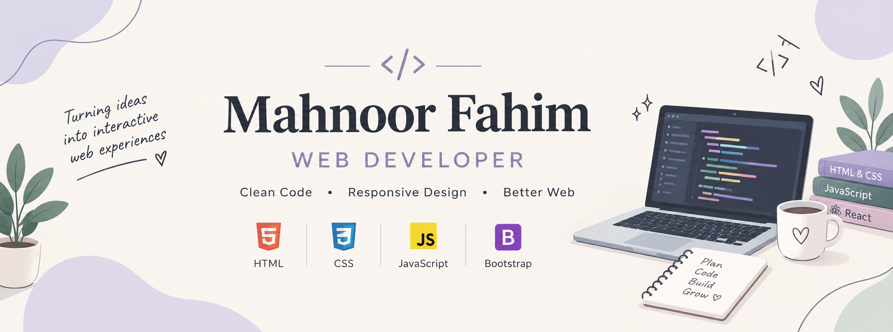

# Hey, I'm Mahnoor Fahim! 👋💗

### 🌷 Web Developer | Graphic Designer | Video Editor

Welcome to my GitHub profile! I'm a passionate learner exploring the world of web development and creative design. I love turning ideas into visually appealing, user-friendly digital experiences.

Currently, I'm wrapping up my JavaScript learning journey and strengthening my programming skills while building projects and improving my creativity.

---

### 💻 About Me

- 🌐 I've learned **HTML5 and CSS3** and use them to build websites.
- ⚡ Currently completing **JavaScript** fundamentals.
- 🎨 I also work as a **Graphic Designer**.
- 🎬 I enjoy **Video Editing** and creating engaging visual content.
- 📚 Always learning, experimenting, and improving my skills.
- 🎯 My goal is to become a skilled **Full-Stack Developer**.

---

### 🛠️ Tech Stack

**Web Development**

**Creative Skills**

🎨 Graphic Design | 🎬 Video Editing

---

### 🚀 Featured Projects

**🏡 ServiceHub | Local Services**
A web development project created during FemHack 2026 at Saylani Zaitoon Ashraf IT Park. The project aims to make discovering and booking local services easier.

🔗 [View Project](https://github.com/mahnoor-fahimali/femhack-2026)

**📚 JavaScript Assignments**
My chapter-wise JavaScript practice and learning journey, based on *A Smarter Way to Learn JavaScript*.

🔗 [View Repository](https://github.com/mahnoor-fahimali/javascript-assigments)

---

### 🌱 Currently Learning

- JavaScript fundamentals and problem-solving
- Building interactive web experiences
- Improving my development and design workflow

---

### 🤝 Let's Connect!

I'm always happy to learn, collaborate, share ideas, and connect with other people in tech and design.

📧 **Email:** mahnoorfahim77@gmail.com

💼 **Fiverr:** [Visit My Profile](https://www.fiverr.com/users/mahnoor_fahim/)

---

⭐ *Thanks for visiting my profile! Keep learning, keep creating, and keep growing.* 🌸
